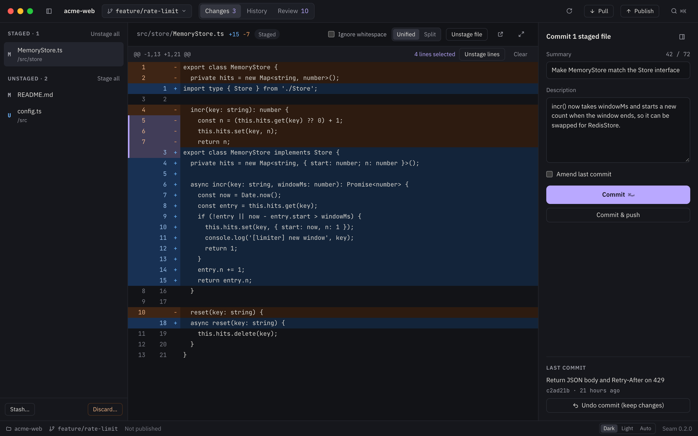
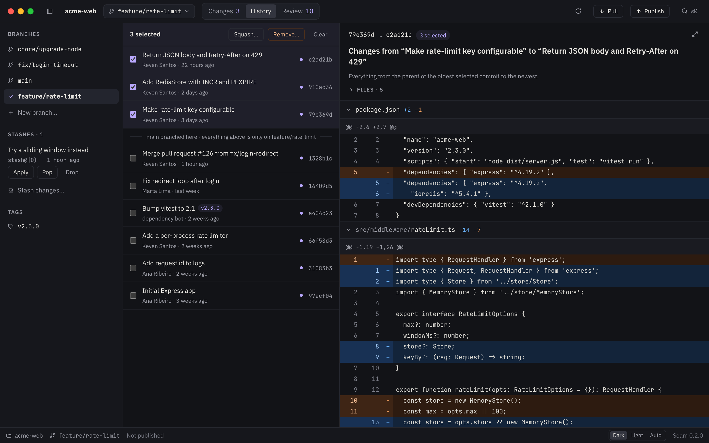
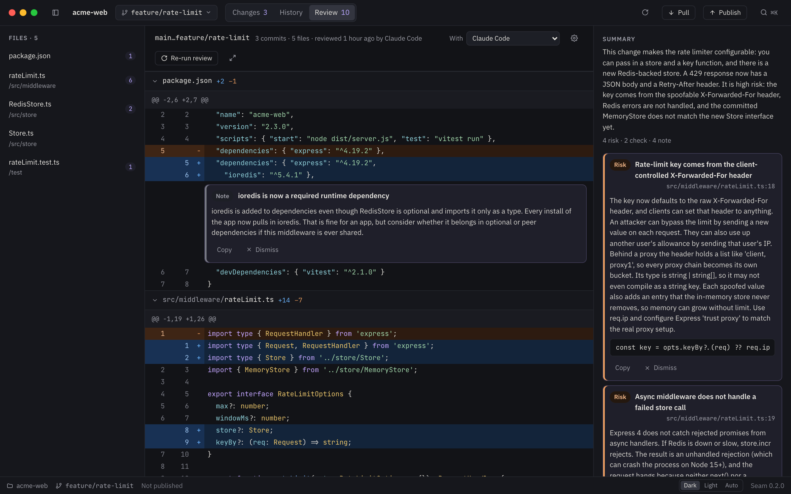
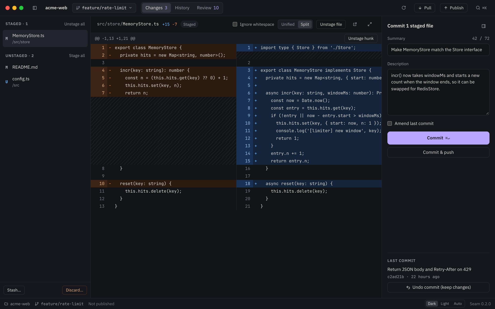
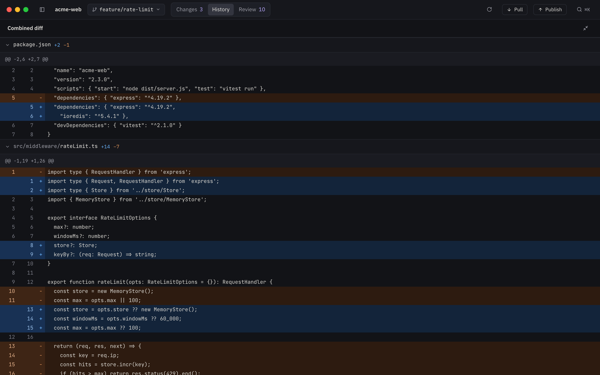
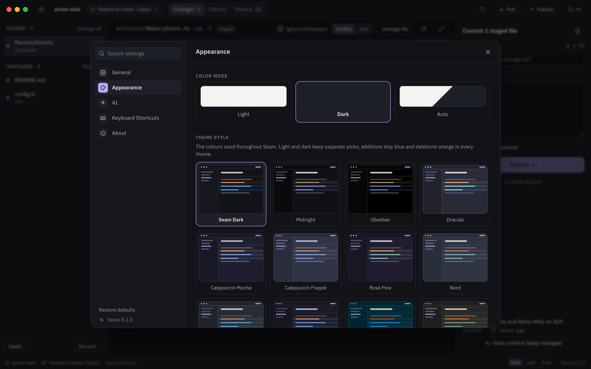
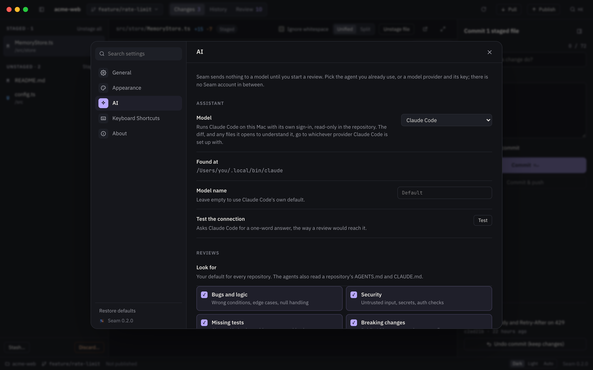

# Seam

A desktop git client for everyday git, built with Tauri 2, React, TypeScript and Tailwind. Stage single
lines, commit, stash, rename or remove commits, and undo any of it with ⌘Z.



[Website](https://kevenleone.github.io/seam/) · [Download](https://github.com/kevenleone/seam/releases/latest)

- **Overview**: what the project is, the first thing you see when there is nothing to commit:
  its stack, languages, activity, where work happens and how to run it, read straight from git
  and the manifests. Ask the AI to add its purpose, an architecture diagram, what lives where and
  where to start reading; when new commits touch a part of it, update just that part.
- **Changes**: stage, unstage or discard single lines and hunks; commit or amend. Diffs are
  syntax highlighted for the common languages, in every theme.
- **History**: ⌘/⇧-click commits to squash, remove, cherry-pick or see their combined diff;
  rename, revert or reset any commit; branches, stashes and tags.
- **Review**: an AI review of the branch with comments on the lines they refer to, by the
  coding agent you already use (Claude Code, Codex, OpenCode) or a model provider under your
  own key (Anthropic, OpenAI, Google Gemini, or any OpenAI-compatible endpoint such as Ollama).
- **Visual**: a recap of the branch, or a plan for a change you describe, drawn by the same
  model: before/after wireframes with numbered notes, architecture diagrams, decisions, the
  files touched, key diffs and how to test it. Export it as a web page, PDF, Markdown or
  Excalidraw.
- **Menu bar**: recent repositories and a one-click review, with Seam running in the background.
- **Settings** (⌘,): 18 themes with separate light and dark picks, accents, AI provider and review
  style. Expand any diff to fill the window with ⇧⌘E.

- **Terminal**: `seam .` opens the repository you are in. Install the command from **Settings ›
  General › Terminal** or **Seam › Install 'seam' Command in PATH**; it links `/usr/local/bin/seam`
  to a script inside the app, and macOS asks for your password where that folder is not writable.

Everything runs natively: Rust shells out to your git and to the agents' CLIs, and calls the
provider APIs directly. Keys stay in the macOS Keychain.

## Screenshots

| History                                                                               | Review                                                                                          |
| ------------------------------------------------------------------------------------- | ----------------------------------------------------------------------------------------------- |
|  |                      |
|                  |                       |
|   |  |

## Develop

Needs Node 22, pnpm (the version is pinned in `package.json`), Rust stable and git.

```sh
pnpm install
pnpm app:dev                 # Vite + the Tauri window, with hot reload
pnpm build && pnpm test      # parser + integration tests on throwaway repositories
pnpm lint && pnpm format     # ESLint and Prettier; CI checks both
pnpm app:build               # → src-tauri/target/release/bundle/macos/Seam.app and a .dmg
```

`cargo test` needs `dist/` to exist, so build the frontend first. CI
(`.github/workflows/ci.yml`) runs Prettier, ESLint, the frontend build,
`cargo fmt --check`, `cargo clippy -D warnings` and `cargo test`. Releases are
cut by release-please from Conventional Commits and built as a universal macOS
`.dmg`.

Working on the code (architecture, conventions and commit rules) is described
in [AGENTS.md](AGENTS.md).

## Layout

- `src-tauri/src/git/`: everything git, in Rust, by shelling out to your own `git` (so config,
  hooks, credential helpers and SSH behave as in Terminal; the login shell's environment is loaded
  once so hooks find node etc.).
    - `parse.rs`: porcelain v2 status, unified diffs, log, refs, stashes, numstat.
    - `patch.rs`: partial patches for staging, unstaging or discarding single lines.
    - `rewrite.rs`: rename / remove / squash any commit through a scripted `rebase -i`.
    - `repo.rs`: every operation, each returning an `Undoable`.
    - `ops.rs`: the `Op` enum the UI sends, and per-repository undo/redo stacks.
- `src-tauri/src/lib.rs`: Tauri commands, windows (welcome + one per repository), menu,
  file watching, opening folders from Finder/Dock.
- `src/`: the React UI. `lib/store.ts` holds a window's state; `views/` has Welcome, Changes and
  History; `components/` has the virtualized diff, command palette (⌘K) and dialogs.

## How undo works

Before an action, Seam records what it needs to reverse it: the index as a tree
(`git write-tree`), file contents as blobs (`git hash-object -w`), or the old branch tip, kept
alive under `refs/seam/undo/*`. ⌘Z outside a text field undoes the last git action; ⇧⌘Z redoes it.
Pushes can't be undone. Undo history lasts until the window closes.

The website lives in `site/` (`pnpm site:dev`) and deploys to GitHub Pages from `main`.

`app-icon.svg` is the icon source: `pnpm tauri icon app-icon.svg` regenerates `src-tauri/icons`.

## License

[AGPL-3.0-only](LICENSE).
